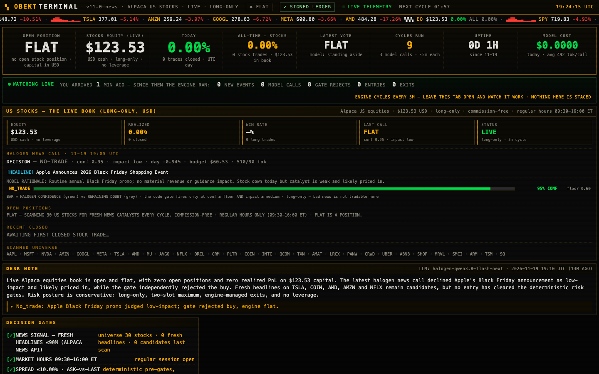
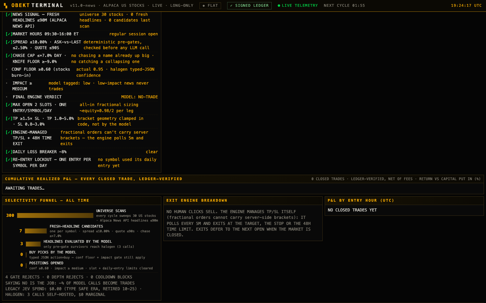
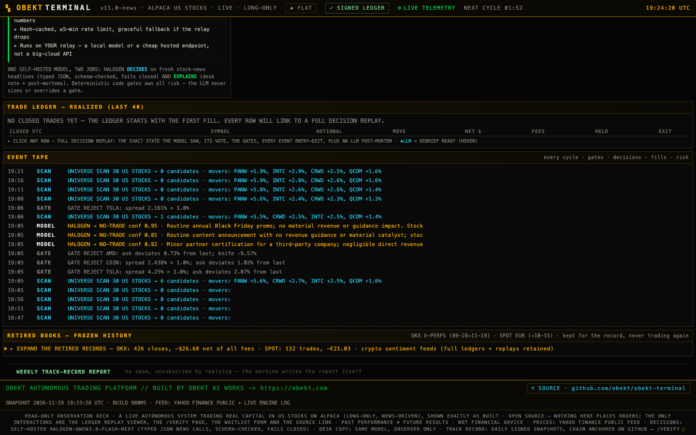
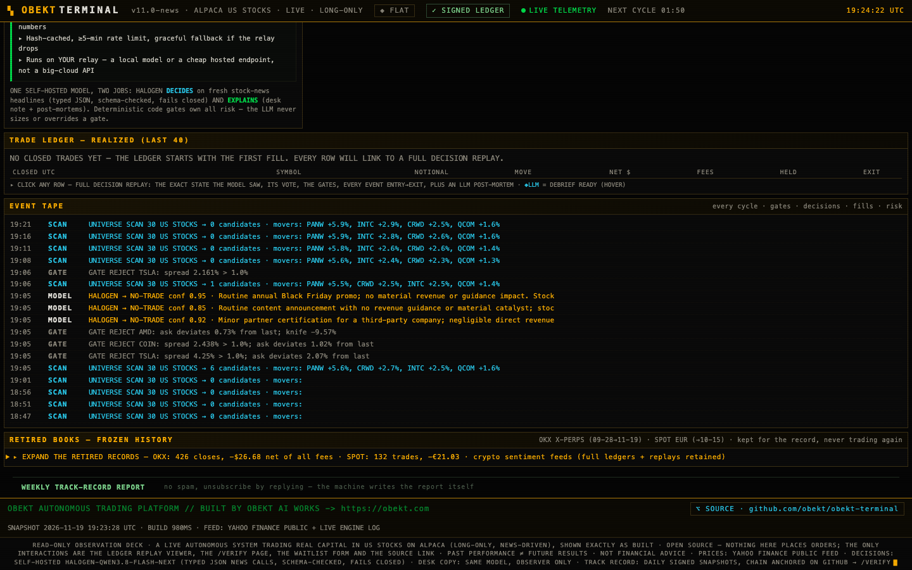

<div align="center">

# ▚ OBEKT AUTONOMOUS TRADING PLATFORM

### A real trading bot, on real money, that reads the news, asks a decision-model, and manages its own risk — and a Bloomberg-style terminal so you can watch every thought it has.

**Open-source · Runs on a self-hosted LLM · Decisions cost $0 marginal · Built by [Obekt AI Works](https://obekt.com)**

### 🔴 [**LIVE DEMO → trader.obekt.com**](https://trader.obekt.com) — watch the real system trade right now
### 🔐 [**PROOF OF TRADES → trader.obekt.com/verify**](https://trader.obekt.com/verify) — daily signed track record, anchored on this repo; verify it in one command



[**▶ LIVE DEMO**](https://trader.obekt.com) · [**What it is**](#what-this-is) · [**Live screenshots**](#what-it-looks-like) · [**How it thinks**](#how-it-thinks-the-architecture) · [**Run it**](#run-it) · [**The terminal**](#the-observation-terminal) · [**Costs**](#what-it-costs) · [**⚠ Disclaimer**](#the-boring-but-important-part)

</div>

---

> ### ⚠️ THIS IS NOT FINANCIAL ADVICE. IT IS A PURE EXPERIMENT.
>
> This is an **educational experiment** and a **portfolio piece**. It trades **real money** and it **can and does lose money** — the retired books below finished at a loss, and the live stocks book has **no demonstrated edge yet**. Nothing here is a recommendation, a solicitation, a signal service, or a promise of profit. Automated trading can lose your entire balance. **Do not run this with money you cannot afford to set on fire.** If you trade on it, you own every consequence. See [DISCLAIMER.md](DISCLAIMER.md).

---

## What this is

Most "AI trading bot" repos are a backtest with a line chart. This is not that.

This is a **fully autonomous system that trades live US stocks on real capital, unattended** — and a **read-only terminal** that streams every decision it makes, so you can watch an agent *think* in real time.

**Venue change, 2026-11-19:** the platform moved from OKX EEA crypto X-Perps to **Alpaca US stocks**. The crypto books are retired (their full losing records stay public below); the live book is now a **news-driven, long-only US-equity engine**. The signed track-record chain continues unbroken across the change.

Two pieces, both in this repo:

| | What it does |
|---|---|
| **`engine/`** — the trader | **One live book.** `alpaca_stocks.py` (**LIVE**, v11.0-news) polls the **Alpaca News API + Yahoo per-ticker RSS** for fresh headlines on a 60-name liquid US-stock universe (30 mega-caps + 30 news-heavy mid/high-beta names), asks a **self-hosted halogen** model for a *typed* JSON verdict (`action buy\|no_trade`, confidence, impact, target/stop, horizon, rationale), and — only if deterministic code gates clear — buys **fractional shares long-only** and manages the exit itself (TP/SL + 48h time exit). **Risk lives in code, never in the model:** the LLM never sizes a position or overrides a gate, and any model error fails closed to `no_trade`. The retired OKX engines (`okx_perp.py` X-Perps, `okx_jev.py` spot EUR, `okx_mom.py` fade) stay in the tree as honest history and as a library the deck still reads. |
| **`terminal/`** — the observation deck | A **Bloomberg-style text UI** (pure HTML/CSS/JS, no framework) that reads the engine's raw logs and renders them: an always-visible open-position badge, the live stocks book, equity curve, selectivity funnel, decision scatter, the exact headline + price context the model saw, a candlestick replay of every trade, and a **local LLM** writing the desk commentary. Stocks-first; the retired crypto books live in one collapsed block at the bottom. **Nothing is clickable except the trade replay** — it is observation only, by design. |

The thesis, in one line: **a self-hosted typed decision-model chooses, deterministic code enforces risk, a local LLM explains, and a human watches — none of them parse each other's prose.**

---

## What it looks like

Every number below is real, pulled live from the running engine. Including the losses (the retired books) and the flat, no-trade cycles (the live book standing aside is the system working, not idling).

<table>
<tr>
<td width="50%"><br/><sub><b>1 · The live deck.</b> Hero KPIs ($123.53 equity, day P&L, cycles run, model calls at $0 marginal), the session-liveness strip, the LLM desk note, and a stock ticker marquee (SPY/QQQ + megacaps, keyless Yahoo Finance). The latest halogen call is a <b>NO-TRADE</b> on an Apple promo headline — conf 0.95 but impact <i>low</i>, so the code gate stands aside.</sub></td>
<td width="50%"><br/><sub><b>2 · Why it barely trades.</b> The <b>decision-gate checklist</b> (news freshness, market hours, spread/ask/quote pre-gates, chase/knife guards, conf floor, impact, slots, bracket geometry, breaker) and the <b>selectivity funnel</b> — universe scans → fresh-headline candidates → model calls → buy picks → opens. Saying "no" is the job.</sub></td>
</tr>
<tr>
<td width="50%"><br/><sub><b>3 · The tape.</b> The <b>event tape</b> streams every cycle as SCAN / GATE / MODEL rows — including the deterministic gate rejects (spread, ask-deviation, knife) and the halogen no-trade rationales. The <b>trade ledger</b> shows its honest empty state: no closed stock trades yet.</sub></td>
<td width="50%"><br/><sub><b>4 · The honest history.</b> The retired crypto books, collapsed at the bottom: <b>OKX X-Perps — 426 closes, −$26.68 net of all fees</b>; <b>spot EUR — 132 trades, −€21.03</b>. Full ledgers and replays retained. Deleting a losing history would be dishonest.</sub></td>
</tr>
</table>

And the piece that makes people lean in — **click any closed trade in the ledger** and you get a full **decision replay**: the candlestick chart with entry/exit + TP/SL marked, the model's vote and rationale, the exact headline + price context it was shown, the pre-entry gauntlet it survived, the full lifecycle timeline, the ledger outcome, and a one-line LLM post-mortem. The live stocks book has not closed a trade yet, so the ledger shows its honest empty state — every row will link to a replay once the first fill lands. The replay viewer is wired and the 500+ retired OKX dossiers are retained in `sample_data/dossiers/` (the retired books themselves are shown as collapsed summaries).

---

## How it thinks (the architecture)

The system has **one live book** (Alpaca US stocks) and **two retired books** (OKX X-Perps and spot EUR) kept as frozen history.

- **US STOCKS** (`engine/alpaca_stocks.py`, v11.0-news) — **LIVE**. News-driven,
  **LONG-ONLY**, fractional shares, USD cash, **no leverage** at this equity
  (leverage needs $2k under Alpaca's intraday framework; shorting needs margin
  approval). **Commission-free** stocks — the only trading costs are a tiny
  sell-side SEC/TAF regulatory fee (~0.003% on closes) and the spread.
  **Regular hours only** (09:30–16:00 ET): overnight/weekend gap risk is real and
  accepted at experimental scale — exits cannot execute while the market is
  closed, so they defer to the next open. Capital: **$123.53**.
- **OKX X-PERPS** (`engine/okx_perp.py` / `okx_mom.py`) — **RETIRED 2026-11-19**.
  Two-way USD-settled MiFID expiry-perps. Final record: **426 closes, 40.8% win
  rate, −$26.68 net of all fees on $134.19 capital** (2026-10-15→11-19, last
  engine v10.0-fade). The account value was moved to Alpaca; the timer is
  disabled and the kill switch set.
- **OKX SPOT EUR** (`engine/okx_jev.py`) — **RETIRED 2026-10-15**. Long-only EUR
  pairs, **132 trades, −€21.03** (34.8% win rate, profit factor 0.62). Source and
  full ledger retained.

**Why move, measured rather than assumed:** the OKX fade edge was venue-specific
and did **not** survive its kill-gate; both crypto books finished negative. A
60-day / 1,078-headline drift study on the new venue showed **raw news has no
blind edge** (post-news 4h absolute move 1.01% vs a 1.48% unconditional baseline).
So the hypothesis is not "news moves stocks" — it is that **the LLM catalyst
filter** (separating genuine high-impact catalysts from routine noise) is where
any edge has to come from. That is unproven. The stocks book launches with a
**pre-registered kill-gate: 30 closed trades OR 14 days, whichever first; live
realized net ≤ 0 → replace the algorithm** (the operator's standing rule: failed
algorithms get replaced, not silently stopped).

```
   every 5 minutes, unattended (entries only in regular market hours):
   ┌─────────────────────────────────────────────────────────────┐
   │ 1. SCAN      Alpaca News API · fresh headlines ≤90m         │
   │              on a 60-name US-stock universe · wire + RSS    │
   │ 2. FILTER    one candidate per symbol · dedupe seen ids     │  ← deterministic code
   │              one entry per symbol per day                   │
   │ 3. PRE-GATE  ask-vs-last ≤2.5% · quote ≤90s · spread guard  │     before any LLM call
   │              chase ≤+7% day · knife ≥−9% day                │
   │ 4. DECIDE    halogen → typed JSON: action buy|no_trade,     │  ← self-hosted, $0 marginal
   │              confidence, impact, target/stop, horizon       │     fails closed to no_trade
   │ 5. VETO      conf ≥0.60 AND impact ≠ low · MAX_OPEN 2 slots │  ← code owns risk
   │ 6. SIZE      equity × 0.98 / 2 per leg · fractional shares  │
   │              TP 1–5% / SL 0.8–3% · enforce TP ≥ 1.5× SL     │
   │ 7. EXECUTE   market order · regular hours 09:30–16:00 ET    │
   │ 8. MANAGE    engine-managed TP/SL (5m poll) + 48h time exit │  ← fractional orders can't
   │              −8% daily breaker (UTC auto-clear) · kill files│     carry server brackets
   └─────────────────────────────────────────────────────────────┘
                          │
                          ▼  raw JSONL telemetry (every scan, gate, vote, fill)
   ┌─────────────────────────────────────────────────────────────┐
   │ THE TERMINAL  reads the logs → renders them → a local LLM   │
   │               writes the desk note. Observation only.       │
   └─────────────────────────────────────────────────────────────┘
```

**The key design decision:** the decision model returns **typed JSON** (`action`,
`confidence`, `impact`, `target_pct`, `stop_pct`, `horizon_hours`, `rationale`) —
**never free text**. So there is no prompt-injection surface, no number
hallucination, and nothing to parse. Any transport/parse/schema failure **fails
closed to `no_trade`**. The model is an *advisor*; **deterministic code is the risk
manager** and holds veto power. The local LLM only ever *explains* facts already in
the engine state — it never decides, and it can't invent a number that isn't there.

**Telemetry compatibility:** the stocks engine deliberately **reuses the OKX-era
filenames and event vocabulary** (`perp_log.jsonl`, `perp_status.json`, `perp_jev` /
`perp_open` / `perp_close` / `mom_scan` events). Key names like `usdc_equity` are
historical identifiers carrying **USD**. That is why the deck's adapter and the
signed chain keep working across the venue change with no rewrite. The OKX-era
files are archived `*_okx_retired`; the chain continues unbroken (seq 11 is the
first Alpaca payload).

Full detail lives in the skills: [`skills/alpaca-trading`](skills/alpaca-trading/SKILL.md) (the live venue, the news engine, the API/data quirks), [`skills/system-one-decisions`](skills/system-one-decisions/SKILL.md) (how to use a typed decision model well), and [`skills/okx-trading`](skills/okx-trading/SKILL.md) (the retired venue, kept for the record).

---

## Run it

There are two things you can run. **The terminal needs no credentials** — you can be looking at it in 30 seconds.

### A) Just the terminal (zero credentials, 30 seconds)

See the dashboard with real frozen telemetry from our live run:

```bash
cd terminal
cp sample_data/data.js data.js
cp sample_data/data.json data.json
cp sample_data/og.png og.png
cp -r sample_data/dossiers dossiers
python3 -m http.server 8770
# open http://localhost:8770
```

That's it — the full deck, charts, and click-to-replay trade dossiers, driven by our real (anonymized) data. No keys, no network, no risk.

> **Maintainers:** `sample_data/` is a *frozen* snapshot and nothing regenerates it
> automatically, so it rots silently after any payload change. Run
> `terminal/refresh-sample.sh <live-state-dir|user@host:path>` before committing. It
> stages into a temp dir, secret-scans and schema-checks there, and only swaps into
> `sample_data/` if everything passes, so bad input cannot corrupt the repo.
> Exit 1 = schema, 2 = secret flagged, 3 = usage.

### B) The full live system (your capital, your keys, your responsibility)

Read [DISCLAIMER.md](DISCLAIMER.md) first. Then:

**1. Prerequisites**

- Python 3.9+ (stdlib only — no pip dependencies for the engine).
- **An Alpaca account for US stocks.** Keys are **Trading API keys** from
  [app.alpaca.markets](https://app.alpaca.markets). Alpaca supports international
  clients in many jurisdictions — **verify yours is eligible** before funding.
  The engine targets the **live** endpoints (`api.alpaca.markets` for trading,
  `data.alpaca.markets` for quotes/news); for paper trading you would adapt the
  base URLs to Alpaca's paper host. Fractional trading must be enabled; the
  minimum notional is **$1**.
- **Long-only at small equity.** Under Alpaca's intraday margin framework,
  leverage needs **$2k** equity and shorting needs margin approval; below that the
  book is effectively 1× long-only. The **PDT rule was retired by FINRA (06-2026)**
  — no day-trade count limit, no $25k minimum.
- **Regular hours only.** The engine trades 09:30–16:00 ET. Outside them it
  accumulates news and defers exits to the next open. Overnight/weekend **gap risk
  is real** — a stop cannot execute while the market is closed.
- An **OpenAI-compatible chat endpoint** for the decision model. The default is
  the operator's self-hosted halogen relay (`chat.obekt.com/v1`, $0 marginal) —
  you need your own endpoint + key, or the decision path fails closed to
  `no_trade` (the engine still runs, it just never buys). A **local** model works
  (LM Studio, llama.cpp, vLLM, Ollama's OpenAI shim).
- Optionally, a separate endpoint for the desk commentary (also local-friendly).
  Not required: without it the terminal shows fallback commentary.
- Real capital you are prepared to lose entirely. See the disclaimer.

```bash
# exchange keys (Alpaca Trading API — live; read + trade, no withdrawal)
mkdir -p ~/.config/alpaca && cat > ~/.config/alpaca/credentials.json <<'JSON'
{ "key": "YOUR_ALPACA_KEY", "secret": "YOUR_ALPACA_SECRET" }
JSON
chmod 600 ~/.config/alpaca/credentials.json
# ...or export ALPACA_KEY / ALPACA_SECRET instead (env wins over the file).

# decision-model endpoint (any OpenAI-compatible chat completions; local works)
export LLM_URL="http://localhost:1234/v1/chat/completions"   # your relay
export LLM_MODEL="your-flash-model"
export LLM_KEY="YOUR_LLM_KEY"        # or LITELLM_MASTER_KEY; optional for local servers
```

**2. Configure the engine.** All strategy knobs are constants at the top of [`engine/alpaca_stocks.py`](engine/alpaca_stocks.py) (universe, gates, conf floor, bracket clamps, slots, breaker, time exit). Read them. Change them. They are the whole strategy. The deck **parses these from source** so the UI can never drift from what the engine enforces.

**3. Do a dry run first (zero orders).**
```bash
cd engine
python3 alpaca_stocks.py status                       # account + positions summary (read-only)
python3 alpaca_stocks.py scan                         # news scan + universe day-movers (read-only)
PAPER_EQUITY_USD=123.53 python3 alpaca_stocks.py cycle --dry-run   # FULL decision path, ZERO orders
```
`--dry-run` runs the entire scan → gate → decide → (virtual) fill → manage path with a paper equity you set, and places **no orders**. Missing credentials → the engine exits with a setup message (code 2), not a traceback.

**4. Loop it live.** The engine is one-shot by design — a scheduler calls `cycle` every 5 minutes. `cycle` places **real orders**:
```cron
*/5 * * * * cd /path/to/engine && /usr/bin/python3 alpaca_stocks.py cycle >> cycle.log 2>&1
```
Kill switch: `touch engine/STOP` (or `engine/STOP_PERP`) halts new entries instantly; management of open positions continues. A daily-breaker STOP auto-clears at UTC midnight.

A systemd timer is sturdier than cron (catch-up after downtime, journald logs). Example unit files — **replace `/srv/obekt/engine` with your install path**:

```ini
# /etc/systemd/system/obekt-stocks.service
[Unit]
Description=Obekt autonomous US-stocks news trader — one full cycle
After=network-online.target

[Service]
Type=oneshot
WorkingDirectory=/srv/obekt/engine
ExecStart=/usr/bin/python3 /srv/obekt/engine/alpaca_stocks.py cycle
TimeoutStartSec=240
NoNewPrivileges=true
PrivateTmp=true
ProtectSystem=full
ReadWritePaths=/srv/obekt/engine
```
```ini
# /etc/systemd/system/obekt-stocks.timer
[Unit]
Description=Run obekt-stocks cycle every 5 minutes

[Timer]
OnCalendar=*:0/5
AccuracySec=20s
Persistent=true          # catch up a run missed while the box was down

[Install]
WantedBy=timers.target
```
```bash
systemctl daemon-reload && systemctl enable --now obekt-stocks.timer
systemctl list-timers obekt-stocks.timer      # confirm the next fire
```

**5. Run the terminal over the live log.**
```bash
cd terminal
# OKX_TERMINAL_BASE is a HISTORICAL env name (kept so existing setups work); it
# now points at the Alpaca engine's directory — the dir holding perp_log.jsonl.
export OKX_TERMINAL_BASE=/path/to/engine
# optional: keep generated artifacts (dossiers, caches) on a persistent path so
# a restart doesn't re-spend LLM calls rebuilding them
export TERMINAL_STATE_DIR=/var/lib/obekt-terminal
# optional desk-commentary LLM (any OpenAI-compatible endpoint; local works):
export TERMINAL_LLM_URL="http://localhost:1234/v1/chat/completions"
export TERMINAL_LLM_MODEL="qwen3-flash"
python3 serve.py --port 8770     # rebuilds from the live log every 45s
```

See [`engine/README.md`](engine/README.md) and [`terminal/README.md`](terminal/README.md) for the full details, every env var, and how to host the terminal publicly.

---

## The observation terminal

A single-page, zero-dependency text UI — no React, no build step, no CDN. Just `index.html`, `style.css`, `app.js`, and a `data.js` the generator rebuilds from the engine's raw log.

- **Stocks-first panels**: hero KPIs · session-liveness counter · LLM desk note · the live stocks book (equity, last halogen call + rationale, open positions, recent closed) · decision gates · equity curve · selectivity funnel · decision scatter · exit-engine breakdown · universe scan · **news** (the live signal, from `stocks_news.json`) · decision vote tape · daily P&L · architecture · model stack · cost optimization · decision economics · trade ledger · event tape. The retired crypto books (and their sentiment feeds) sit in one **collapsed `RETIRED BOOKS` block** at the bottom.
- **Real-time feel**: the page polls `data.js` every 10s, new tape rows flash, the tab title blinks on a fill, and a live `NEXT CYCLE` countdown ticks from the last engine event.
- **Click-to-replay dossiers**: every closed trade stores an immutable replay (chart + vote + prompt state + timeline + LLM post-mortem).
- **Honest empty states**: no closed trades yet, no model calls yet, market closed — each panel says so explicitly rather than rendering stale data as live.
- **Read-only by construction**: `cursor:default`, `user-select:none`, no links or handlers anywhere except the ledger replay and the footer's source link. You literally cannot place an order from it.

---

## What it costs

The economics panel says it better than we can, but the headline:

- **Decisions:** the halogen decision model is **self-hosted at $0 marginal cost**. A full news call is one headline + summary + price context (a few hundred tokens), at most 4 calls per cycle. Thousands of decisions for the price of the hardware you already run.
- **Desk commentary:** runs on **your local model** (or any cheap endpoint) — effectively free, cached, and optional.
- **Trading:** stocks are **commission-free**. The only costs are a tiny sell-side **SEC/TAF regulatory fee (~0.003% on closes)** and the **spread**. With fees near zero, the whole game is **signal quality** — fresh, high-impact news the market hasn't priced in — which is exactly why the chase guard exists. (The retired OKX era was the opposite: exchange fees dominated every result. The deck's economics panel splits the legacy paid TypeSafe spend from the self-hosted halogen era so you can see the difference.)

---

## For agents

This whole thing is written to be **operated by an AI agent**, not just a human. The `skills/` directory is the operating manual in [Hermes Agent](https://hermes-agent.nousresearch.com) skill format — drop them in and an agent can run, tune, and debug the system:

- [`skills/alpaca-trading`](skills/alpaca-trading/SKILL.md) — the live venue: account/credentials, the news engine architecture, the Alpaca API/data quirks, the fund-move route, every pitfall.
- [`skills/system-one-decisions`](skills/system-one-decisions/SKILL.md) — how to use a typed decision model: atomic questions, confidence/impact gating, state design, calibration by replay.
- [`skills/okx-trading`](skills/okx-trading/SKILL.md) — **RETIRED** venue, kept as historical reference (the fee wall, the X-Perp shorting path, the live pitfalls we hit).

---

## Repository layout

```
├── README.md               ← you are here
├── DISCLAIMER.md           ← read it
├── LICENSE                 ← MIT (code) — no warranty, no advice
├── docs/screenshots/       ← the images above
├── engine/                 ← the autonomous trader
│   ├── alpaca_stocks.py    ← LIVE: news→halogen→code gates→fractional long→manage
│   ├── stocks_health.py    ← compact JSON health snapshot (watchdog input)
│   ├── verify_snapshot.py  ← daily signed equity snapshot (GET-only, isolated)
│   ├── okx_perp.py         ← RETIRED X-Perp execution host + Jev book (history)
│   ├── okx_mom.py          ← RETIRED deterministic fade engine (history)
│   ├── okx_jev.py          ← RETIRED spot EUR engine (history + library)
│   ├── news_feed.py / social_feed.py  ← retired spot-era keyless feeds
│   └── README.md
├── terminal/               ← the read-only observation deck
│   ├── index.html  app.js  style.css
│   ├── generate.py         ← log → data.js (+ LLM desk note, cached)
│   ├── serve.py  deploy.sh  make_og.py
│   ├── refresh-sample.sh   ← refresh sample_data/ safely (scan + schema gate)
│   ├── sample_data/        ← frozen real telemetry → preview with ZERO credentials
│   └── README.md
├── verify/                 ← proof-of-trades public anchors (do not edit by hand)
│   ├── verify.py  pub.pem  HEAD.json  README.md
└── skills/                 ← agent operating manuals
    ├── alpaca-trading/
    ├── system-one-decisions/
    └── okx-trading/        ← retired venue
```

---

## Proof of trades

Every day at 00:03 UTC an isolated script reads the **venue's own equity and
open positions** (GET-only — Alpaca now, OKX through 2026-11-19), signs them
(ed25519) into a hash chain, and pins the chain head as a commit in this repo
(`verify/HEAD.json`) — so the track record is timestamped by a third party and
cannot be quietly rewritten. **The chain continues unbroken across the venue
change:** pre-cutover entries carry `okx_*` payload keys, later entries carry
`alpaca_*` keys; same signing key, same sequence.

```bash
pip install cryptography
curl -sL https://trader.obekt.com/verify.py | python3 -
```

Full design and honest limits: [`verify/README.md`](verify/README.md).

---

## Security & secrets

This repo contains **no keys, no credentials, and no personal infrastructure**. The engine reads keys from `~/.config/alpaca/credentials.json` (or env) at runtime; the terminal reads an LLM key from an env var. Nothing is committed. Before publishing we scanned every source file and the sample telemetry for secrets and personal identifiers — see [SECURITY.md](SECURITY.md) for what we checked and how to run your own audit.

---

## The boring but important part

- **Not financial advice.** Not investment advice. Not a signal service. Not a product. An experiment, published as-is.
- **It has lost money, and may again.** The retired OKX X-Perp book finished **−$26.68** (426 closes, 40.8% win rate) and the spot EUR book **−€21.03** (132 trades, profit factor 0.62). The live stocks book has **no demonstrated edge yet** — it launches with a pre-registered kill-gate (30 closes or 14 days, net ≤ 0 → replace). We show the real numbers because fake ones would be a lie.
- **You are responsible.** If you point this at a funded account, every fill, every loss, and every consequence is yours alone.
- **No warranty.** MIT-licensed, zero warranty, zero liability. See [LICENSE](LICENSE) and [DISCLAIMER.md](DISCLAIMER.md).
- **Do your own research.** Then do more. Then assume you're still missing something.

---

<div align="center">

**Built by [Obekt AI Works](https://obekt.com)** — agents that do real things on real systems.

If you looked at this and thought *"I want one of these for my book / my stack / my idea"* — that's exactly what we build. **[obekt.com](https://obekt.com)**

⭐ If this made you go "huh, that's actually real" — star it. It helps other people find it.

</div>